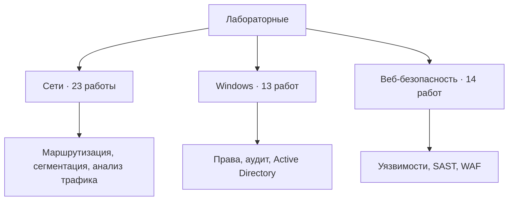

# Лабораторные по информационной безопасности

Лев Устинов · recently_was_good

Разборы практических работ по сетям, Windows и безопасности веб-приложений.

[Сети](labs/network/README.md) · [Windows](labs/windows/README.md) · [Web / OWASP](labs/web/README.md) · [Карта OWASP](docs/owasp-coverage.md)



## Три направления · 50 лабораторных

| Направление | Содержание | Практики |
| :-- | :-- | :--: |
| [Сети и сетевая безопасность](labs/network/README.md) | Адресация, OSPF, DNS, VLAN, NAT, VPN, анализ атак и Suricata | **23** |
| [Windows и доменная инфраструктура](labs/windows/README.md) | Службы, права, реестр, удалённый доступ, аудит, Sysmon, AD DS, IIS, AD CS и GPO | **13** |
| [Веб-безопасность / OWASP](labs/web/README.md) | Burp Suite, анализ уязвимостей, SAST, DefectDojo и WAF SafeLine | **14** |

## О портфолио

Учусь на кафедре компьютерной безопасности ТОГУ и развиваюсь в направлении SOC / Blue Team. Здесь собраны разборы выполненных учебных лабораторных: как устроен стенд, что проверяется, какие следы остаются и как устранить первопричину.

В каждой лабораторной схема и краткий список выполненных действий.

## Как устроен репозиторий

```text
praaactice/
├── README.md                    # Обзор и навигация
├── labs/
│   ├── network/                 # 23 сетевые лабораторные
│   ├── windows/                 # 13 Windows-лабораторных
│   └── web/                     # 14 веб-лабораторных
├── docs/
│   ├── lab-environment.md       # Подготовка и границы стендов
│   ├── owasp-coverage.md        # Сопоставление с OWASP Top 10:2025
│   ├── source-map.md            # Связь с каждым кейсом архива
│   └── sources.md               # Учебные и официальные источники
├── templates/run-report.md      # Шаблон фиксации своего прогона
└── portfolio.json               # Каталог лабораторных
```

## Статус материалов

В этой версии опубликованы схемы и краткие описания выполненных учебных работ. Личные PCAP, EVTX и скриншоты прогонов пока не приложены.

Практический веб-блок покрывает часть категорий OWASP Top 10:2025. Он не обозначен как полное прохождение всех десяти категорий: [таблица покрытия](docs/owasp-coverage.md).

## Профили

- [Hack The Box](https://app.hackthebox.com/users/3068176)
- [Команда Vl3ss: результаты CTF и разборы задач](https://vl3ss.github.io/Vl3ss-website/)
- [GitHub](https://github.com/ustinovlev039-cpu)

