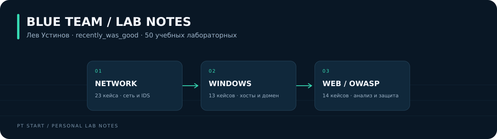

<div align="center">



**Лев Устинов · recently_was_good**

Практика по сетям, Windows и безопасности веб-приложений по материалам PT Start.

[Сети](labs/network/README.md) · [Windows](labs/windows/README.md) · [Web / OWASP](labs/web/README.md) · [Карта OWASP](docs/owasp-coverage.md)

</div>

## Три направления · 50 лабораторных

| Направление | Содержание | Практики |
| :-- | :-- | :--: |
| [Сети и сетевая безопасность](labs/network/README.md) | Адресация, OSPF, DNS, VLAN, NAT, VPN, анализ атак и Suricata | **23** |
| [Windows и доменная инфраструктура](labs/windows/README.md) | Службы, права, реестр, удалённый доступ, аудит, Sysmon, AD DS, IIS, AD CS и GPO | **13** |
| [Веб-безопасность / OWASP](labs/web/README.md) | Burp Suite, анализ уязвимостей, SAST, DefectDojo и WAF SafeLine | **14** |

## О портфолио

Учусь на кафедре компьютерной безопасности ТОГУ и развиваюсь в направлении SOC / Blue Team. Здесь собраны разборы лабораторных, выполненных в рамках PT Start от Positive Technologies: как устроен стенд, что проверяется, какие следы остаются и как устранить первопричину.

Каждая работа оформлена отдельно: со схемой Mermaid, последовательностью действий, командами для контрольных проверок и критериями результата. Номера кейсов сохранены для связи с исходными учебными материалами.

## С чего начать

1. **[Log4Shell и Suricata](labs/network/18-log4shell-detection/README.md)** — от сетевого запроса до разбора сработавшего правила.
2. **[Расширенный аудит Windows и Sysmon](labs/windows/09-audit-sysmon/README.md)** — какие события нужны для расследования.
3. **[IDOR и проверка прав](labs/web/04-idor/README.md)** — серверная авторизация на уровне объекта.
4. **[Bandit → Semgrep → DefectDojo](labs/web/13-sast/README.md)** — сопоставление и разбор результатов статического анализа.

## Как устроен репозиторий

```text
praaactice/
├── README.md                    # Обзор и навигация
├── labs/
│   ├── network/                 # 23 сетевые лабораторные
│   ├── windows/                 # 13 Windows-лабораторных
│   └── web/                     # 14 веб-лабораторных
├── assets/                      # Обложка и схемы направлений
├── docs/
│   ├── lab-environment.md       # Подготовка и границы стендов
│   ├── owasp-coverage.md        # Сопоставление с OWASP Top 10:2025
│   ├── source-map.md            # Связь с каждым кейсом архива
│   └── sources.md               # Учебные и официальные источники
├── templates/run-report.md      # Шаблон фиксации своего прогона
└── portfolio.json               # Каталог лабораторных
```

## Статус материалов

В этой версии опубликованы структурированные конспекты выполненных учебных работ, схемы и контрольные проверки. Личные PCAP, EVTX и скриншоты прогонов пока не приложены. Примеры вывода не выдумываются: фактические результаты фиксируются отдельно по шаблону отчёта.

Исходные образы и точные шаги настройки доступны участнику в материалах программы. Портфолио не содержит дистрибутивов учебных ВМ. [Как подготовить среду](docs/lab-environment.md) · [Как зафиксировать результат](templates/run-report.md).

Практический веб-блок покрывает часть категорий OWASP Top 10:2025. Он не обозначен как полное прохождение всех десяти категорий: [таблица покрытия](docs/owasp-coverage.md).

## Профили

- [Hack The Box](https://app.hackthebox.com/users/3068176)
- [Команда Vl3ss: результаты CTF и разборы задач](https://vl3ss.github.io/Vl3ss-website/)
- [GitHub](https://github.com/ustinovlev039-cpu)

---

Учебное портфолио. Подготовлено по пользовательскому архиву «пт.zip» с указанием источников; не является официальным репозиторием Positive Technologies.
