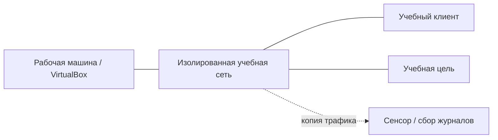

[← На главную](../README.md)

# Подготовка лабораторной среды

## Исходные компоненты

Разборы соответствуют **кейсам учебного архива** из архива «пт.zip». Для точного повторения используются базовые Debian-образы, Windows/Windows Server, MikroTik и отдельные уязвимые приложения, указанные в курсе. Они не входят в этот репозиторий. Контрольные команды дополняют ход работы и не заменяют настройку образов.

| Направление | Базовая среда | Дополнительные компоненты |
| :-- | :-- | :-- |
| Сети | Oracle VirtualBox, Debian, MikroTik | OPNsense, Suricata, EveBox, Wireshark; по кейсу |
| Windows | Windows и Windows Server на отдельных ВМ | AD DS, AD CS, IIS, Sysmon, Sysinternals; по кейсу |
| Web | Debian и учебное приложение | Burp Suite, Docker Compose, DefectDojo, Bandit, Semgrep, SafeLine |

Найденные в локальных папках `VirtualBox VMs` и `Downloads` образы для сетевых, Windows и веб-кейсов перечислены в [каталоге образов](vm-inventory.md).

Версии ПО фиксируются перед прогоном. Синтаксис RouterOS, наборы правил анализаторов и состав событий могут меняться; в кейсе используется фактическая версия стенда, а не обещание совместимости с любой версией.

## Сеть и адреса

Для атакующих сценариев используются Internal Network или Host-only. Bridged Adapter не нужен для взаимодействия с обычной домашней сетью. При необходимости установки пакетов временный NAT-адаптер применяется на этапе подготовки, а перед экспериментом проверяется фактический путь трафика.

В документации встречаются примеры адресов `192.168.1.0/24`, `192.168.2.0/24` и домен `lab.example.test`. Это **образцы**, не универсальная конфигурация. В исходных кейсах могут использоваться другие диапазоны. Перед запуском команд сверяются:

1. Адрес, маска, шлюз и DNS каждого узла.
2. Имя интерфейса и тип адаптера VirtualBox.
3. Прямой и обратный маршрут.
4. Точка захвата и зеркалирование трафика.
5. Доступность источника журналов и синхронизация времени.

## Порядок прогона

1. Зафиксировать версии и сделать снимок ВМ.
2. Проверить обычную работу сервиса и сохранить исходные настройки.
3. Выполнить сценарий конкретного кейса и записать временной диапазон.
4. Проверить не только ответ клиента, но и соответствующее состояние сервера, событие или поток.
5. Применить исправление и повторить исходную проверку.
6. Вернуть учебные настройки, удалить маркеры и подтвердить штатную работу.

## Фиксация доказательств

Для сетевого события сохраняются время, адреса, порты, протокол, flow_id и SID/rev, если было срабатывание IDS. Для Windows — узел, журнал, provider, Event ID, время и контекст пользователя/процесса. Для веба — запрос, ответ, состояние приложения и проверка после исправления.

Все события приводятся к одной временной зоне при сопоставлении. Формат и источник времени сохраняются: Sysmon использует UTC в своих полях. Вместо выдуманного вывода используется [шаблон отчёта](../templates/run-report.md) с фактическими данными прогона.
