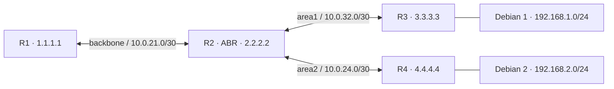

# Динамическая маршрутизация OSPF

## Схема

## Что сделал

- Собрал OSPF-топологию из четырёх MikroTik с областями backbone, area1 и area2.
- Настроил router-id, соседство и распространение маршрутов.
- Проверил связь между клиентами через OSPF-маршруты.
