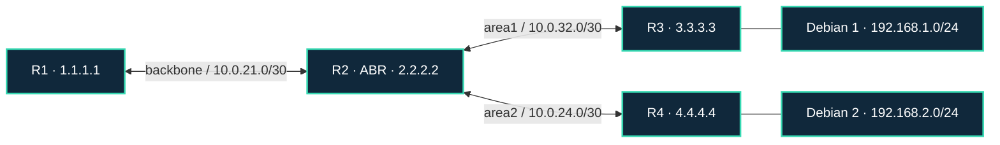

[Портфолио](../../../README.md) / [Сети](../README.md) / NET-05

# NET-05 · Динамическая маршрутизация OSPF

> Собрать многообластную OSPF-топологию из четырёх MikroTik и проверить распространение маршрутов.

| Формат | Исходный кейс | Основной фокус |
| :-- | :-- | :-- |
| Учебная практика PT Start | `815` | Сети |

## Стенд и схема

Debian и сетевые ВМ по схеме кейса. Адреса и имена интерфейсов в командах — примеры, их нужно сверить с фактической схемой.



Схема показывает логику лабораторной. Для точного повторения исходного кейса используются его адресный план, образы и версии компонентов. Подготовка среды описана в [руководстве по стендам](../../../docs/lab-environment.md).

## Ход работы

1. Воссоздать связи: R1—R2 в backbone, R2—R3 в area1, R2—R4 в area2; клиенты находятся за R3 и R4.
2. Назначить уникальные router-id и транзитные сети /30.
3. Создать экземпляры OSPF, области и interface-template согласно версии RouterOS.
4. Проверить соседство и OSPF-маршруты, затем временно отключить один учебный линк и наблюдать сходимость.

## Команды и контрольные проверки

```routeros
/routing ospf instance print
/routing ospf area print
/routing ospf neighbor print
/ip route print where ospf
```

Это команды проверки или пример исправления, а не сохранённый вывод с выполненного стенда. Полный набор действий зависит от подготовленного образа и версии ПО.

## Как подтвердить результат

- Схема с областями и router-id.
- Состояния соседей и маршруты до и после изменения топологии.

Для фиксации фактического прогона используется [шаблон отчёта](../../../templates/run-report.md).

## Что важно для SOC

Потеря соседства, изменение стоимости и появление неизвестного router-id важны для диагностики и мониторинга. Объяснить роль R2 как ABR.

## Защита и повторная проверка

Ограничивать участие интерфейсов в OSPF, применять поддерживаемую аутентификацию и контролировать изменения маршрутов.

После изменения конфигурации повторяется исходная проверка: нужно подтвердить устранение причины и сохранение штатной функции, а не только исчезновение ошибки в интерфейсе.

<details>
<summary>Источник и границы разбора</summary>

Тема и порядок действий адаптированы из пользовательского архива **«пт.zip»**, файл `tasks/815_Guided_Case_2.5_-_Динамическая_маршрутизация.md`.
Это сжатый разбор учебной практики с добавленными схемой, критериями подтверждения и аналитическими пояснениями. Результаты чекеров и курсовые флаги не публикуются. Указания по официальной документации: [источники](../../../docs/sources.md).

</details>

---

[← Предыдущая](../04-static-routing/README.md) · [Все лабораторные](../README.md) · [Следующая →](../06-dns/README.md)
