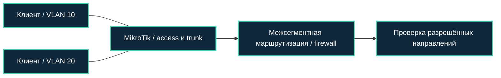

[Портфолио](../../../README.md) / [Сети](../README.md) / NET-07

# NET-07 · VLAN и сегментация

> Разделить клиентов по VLAN и проверить изоляцию широковещательного трафика.

| Формат | Исходный кейс | Основной фокус |
| :-- | :-- | :-- |
| Учебная практика PT Start | `748` | Сети |

## Стенд и схема

Debian и сетевые ВМ по схеме кейса. Адреса и имена интерфейсов в командах — примеры, их нужно сверить с фактической схемой.



Схема показывает логику лабораторной. Для точного повторения исходного кейса используются его адресный план, образы и версии компонентов. Подготовка среды описана в [руководстве по стендам](../../../docs/lab-environment.md).

## Ход работы

1. Составить соответствие портов, PVID и VLAN ID.
2. Настроить access- и trunk-порты на учебном MikroTik.
3. Включить VLAN filtering после проверки доступа к управлению.
4. Проверить обмен внутри VLAN и разрешённые правилами межсегментные соединения.

## Команды и контрольные проверки

```routeros
/interface bridge print
/interface bridge port print
/interface bridge vlan print
/interface vlan print
```

Это команды проверки или пример исправления, а не сохранённый вывод с выполненного стенда. Полный набор действий зависит от подготовленного образа и версии ПО.

## Как подтвердить результат

- Таблица access/trunk/PVID и схема VLAN.
- Проверки разрешённых и запрещённых направлений связи.

Для фиксации фактического прогона используется [шаблон отчёта](../../../templates/run-report.md).

## Что важно для SOC

VLAN разделяет L2-домены, но доступ между VLAN определяется маршрутизацией и firewall. Наличие тегов не доказывает корректную изоляцию.

## Защита и повторная проверка

Не смешивать управление с пользовательским трафиком, явно задавать tagged/untagged-порты и фильтрацию между сегментами.

После изменения конфигурации повторяется исходная проверка: нужно подтвердить устранение причины и сохранение штатной функции, а не только исчезновение ошибки в интерфейсе.

<details>
<summary>Источник и границы разбора</summary>

Тема и порядок действий адаптированы из пользовательского архива **«пт.zip»**, файл `tasks/748_Guided_Case_2.7_-_VLAN.md`.
Это сжатый разбор учебной практики с добавленными схемой, критериями подтверждения и аналитическими пояснениями. Результаты чекеров и курсовые флаги не публикуются. Указания по официальной документации: [источники](../../../docs/sources.md).

</details>

---

[← Предыдущая](../06-dns/README.md) · [Все лабораторные](../README.md) · [Следующая →](../08-nat/README.md)
