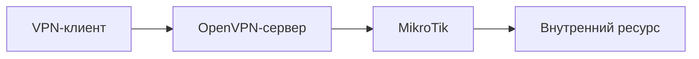

[Портфолио](../../../README.md) / [Сети](../README.md) / NET-09

# NET-09 · OpenVPN и доступ во внутреннюю сеть

> Проверить защищённое подключение внешнего учебного клиента к внутреннему сегменту.

| Формат | Исходный кейс | Основной фокус |
| :-- | :-- | :-- |
| Учебная практика | `816` | Сети |

## Стенд и схема

Debian и сетевые ВМ по схеме кейса. Адреса и имена интерфейсов в командах — примеры, их нужно сверить с фактической схемой.



Схема показывает логику лабораторной. Для точного повторения исходного кейса используются его адресный план, образы и версии компонентов. Подготовка среды описана в [руководстве по стендам](../../../docs/lab-environment.md).

## Ход работы

1. Подготовить VPN-сервер, клиент и MikroTik; разделить внешний и внутренний сегменты.
2. Настроить серверную и клиентскую конфигурации с отдельными сертификатами.
3. Задать маршруты к внутренней сети и обратный маршрут к VPN-пулу.
4. Подключиться, проверить адрес туннеля и доступ только к разрешённым ресурсам; затем отозвать тестовый доступ.

## Команды и контрольные проверки

```bash
ip -br address
ip route
systemctl status openvpn@server
journalctl -u openvpn@server --since "15 minutes ago"
```

Это команды проверки или пример исправления, а не сохранённый вывод с выполненного стенда. Полный набор действий зависит от подготовленного образа и версии ПО.

## Как подтвердить результат

- Схема VPN-пула и маршрутов без приватных ключей.
- События подключения и проверка доступа во внутренний сегмент.

Для фиксации фактического прогона используется [шаблон отчёта](../../../templates/run-report.md).

## Что важно для SOC

Неожиданные подключения, повторные отказы аутентификации и несвойственные маршруты требуют проверки. Проверять действительность сертификата и соответствие пользователя.

## Защита и повторная проверка

Использовать отдельные сертификаты, отзыв доступа, минимальные маршруты и ограничение межсегментного трафика.

После изменения конфигурации повторяется исходная проверка: нужно подтвердить устранение причины и сохранение штатной функции, а не только исчезновение ошибки в интерфейсе.

<details>
<summary>Источник и границы разбора</summary>

Тема и порядок действий адаптированы из пользовательского архива **«пт.zip»**, файл `tasks/816_Guided_Case_2.9_-_OpenVPN.md`.
Это сжатый разбор учебной практики с добавленными схемой, критериями подтверждения и аналитическими пояснениями. Результаты чекеров и курсовые флаги не публикуются. Указания по официальной документации: [источники](../../../docs/sources.md).

</details>

---

[← Предыдущая](../08-nat/README.md) · [Все лабораторные](../README.md) · [Следующая →](../10-3proxy/README.md)
