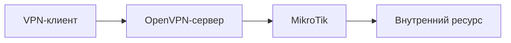

# OpenVPN и доступ во внутреннюю сеть

## Схема

## Что сделал

- Настроил OpenVPN-сервер, клиентское подключение и маршруты во внутреннюю сеть.
- Проверил установление туннеля и доступ к разрешённым ресурсам.
