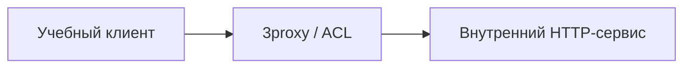

# 3proxy и контроль проксируемого доступа

## Схема

## Что сделал

- Развернул 3proxy и настроил ограничения проксируемого доступа.
- Проверил разрешённые и запрещённые запросы и записи в журнале.
