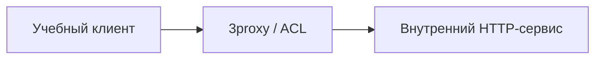

[Портфолио](../../../README.md) / [Сети](../README.md) / NET-10

# NET-10 · 3proxy и контроль проксируемого доступа

> Разобрать путь запроса через прокси и проверить ограничения доступа.

| Формат | Исходный кейс | Основной фокус |
| :-- | :-- | :-- |
| Учебная практика | `817` | Сети |

## Стенд и схема

Debian и сетевые ВМ по схеме кейса. Адреса и имена интерфейсов в командах — примеры, их нужно сверить с фактической схемой.



Схема показывает логику лабораторной. Для точного повторения исходного кейса используются его адресный план, образы и версии компонентов. Подготовка среды описана в [руководстве по стендам](../../../docs/lab-environment.md).

## Ход работы

1. Подготовить внешний клиент, Debian с 3proxy и внутренний ресурс.
2. Настроить один тип прокси и разрешить доступ только учебному клиенту.
3. Проверить разрешённый запрос и отказ для запрещённого направления.
4. Сопоставить запрос с журналом прокси; убедиться, что сервис не стал открытым прокси.

## Команды и контрольные проверки

```bash
ss -lntp
curl --proxy http://192.168.2.2:3128 http://lab.example.test/
```

Это команды проверки или пример исправления, а не сохранённый вывод с выполненного стенда. Полный набор действий зависит от подготовленного образа и версии ПО.

## Как подтвердить результат

- Тип прокси, порт и таблица ACL.
- Разрешённый и запрещённый запросы с журналом доступа.

Для фиксации фактического прогона используется [шаблон отчёта](../../../templates/run-report.md).

## Что важно для SOC

Прокси меняет видимый источник запроса. Для расследования связать клиентскую сессию с записью на прокси, а не ограничиваться адресом, увиденным сервером.

## Защита и повторная проверка

Запретить анонимный доступ, ограничить источники и назначения, включить журналирование.

После изменения конфигурации повторяется исходная проверка: нужно подтвердить устранение причины и сохранение штатной функции, а не только исчезновение ошибки в интерфейсе.

<details>
<summary>Источник и границы разбора</summary>

Тема и порядок действий адаптированы из пользовательского архива **«пт.zip»**, файл `tasks/817_Guided_Case_2.10_-_3proxy.md`.
Это сжатый разбор учебной практики с добавленными схемой, критериями подтверждения и аналитическими пояснениями. Результаты чекеров и курсовые флаги не публикуются. Указания по официальной документации: [источники](../../../docs/sources.md).

</details>

---

[← Предыдущая](../09-openvpn/README.md) · [Все лабораторные](../README.md) · [Следующая →](../11-arp-spoofing/README.md)
