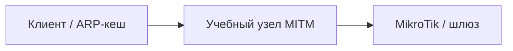

# ARP Spoofing и признаки MITM

## Схема

## Что сделал

- Воспроизвёл ARP Spoofing в изолированном учебном сегменте.
- Сравнил ARP-таблицы и разобрал перехваченный UDP-трафик.
- Остановил сценарий и восстановил исходные настройки.
