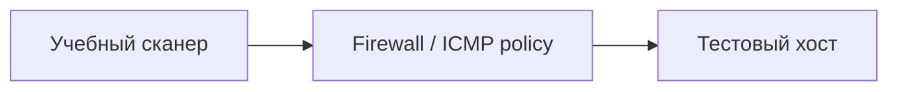

[Портфолио](../../../README.md) / [Сети](../README.md) / NET-13

# NET-13 · ICMP и обнаружение узлов

> Проверить, как разные ICMP-запросы и фильтрация влияют на видимость узла.

| Формат | Исходный кейс | Основной фокус |
| :-- | :-- | :-- |
| Учебная практика | `820` | Сети |

## Стенд и схема

Debian и сетевые ВМ по схеме кейса. Адреса и имена интерфейсов в командах — примеры, их нужно сверить с фактической схемой.



Схема показывает логику лабораторной. Для точного повторения исходного кейса используются его адресный план, образы и версии компонентов. Подготовка среды описана в [руководстве по стендам](../../../docs/lab-environment.md).

## Ход работы

1. Выбрать один собственный учебный хост и зафиксировать правила фильтрации.
2. Выполнить ICMP host discovery и записать применённые флаги.
3. Сравнить результат с доступностью заведомо работающего TCP-сервиса.
4. В захвате отличить Echo Request/Reply от сообщений об ошибках сети.

## Команды и контрольные проверки

```bash
ping -c 3 192.168.1.10
sudo nmap -sn -PE --disable-arp-ping 192.168.1.10
```

Это команды проверки или пример исправления, а не сохранённый вывод с выполненного стенда. Полный набор действий зависит от подготовленного образа и версии ПО.

## Как подтвердить результат

- Параметры проверки и ICMP type/code.
- Сравнение ответа ICMP и доступности учебного сервиса.

Для фиксации фактического прогона используется [шаблон отчёта](../../../templates/run-report.md).

## Что важно для SOC

Серии ICMP к множеству адресов могут быть обнаружением сети. В локальном Ethernet Nmap обычно предпочитает ARP; это нужно учитывать при сравнении захвата.

## Защита и повторная проверка

Разрешать необходимые диагностические ICMP-типы и контролировать частоту запросов вместо полного запрета всего ICMP.

После изменения конфигурации повторяется исходная проверка: нужно подтвердить устранение причины и сохранение штатной функции, а не только исчезновение ошибки в интерфейсе.

<details>
<summary>Источник и границы разбора</summary>

Тема и порядок действий адаптированы из пользовательского архива **«пт.zip»**, файл `tasks/820_Guided_Case_2.13_-_ICMP.md`.
Это сжатый разбор учебной практики с добавленными схемой, критериями подтверждения и аналитическими пояснениями. Результаты чекеров и курсовые флаги не публикуются. Указания по официальной документации: [источники](../../../docs/sources.md).

</details>

---

[← Предыдущая](../12-rogue-dhcp/README.md) · [Все лабораторные](../README.md) · [Следующая →](../14-udp-scanning/README.md)
