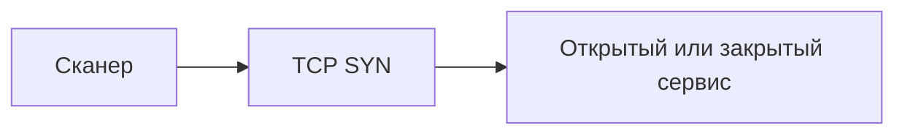

[Портфолио](../../../README.md) / [Сети](../README.md) / NET-15

# NET-15 · TCP-сканирование и состояния портов

> Связать SYN/SYN-ACK/RST с состояниями TCP-портов.

| Формат | Исходный кейс | Основной фокус |
| :-- | :-- | :-- |
| Учебная практика | `822` | Сети |

## Стенд и схема

Debian и сетевые ВМ по схеме кейса. Адреса и имена интерфейсов в командах — примеры, их нужно сверить с фактической схемой.



Схема показывает логику лабораторной. Для точного повторения исходного кейса используются его адресный план, образы и версии компонентов. Подготовка среды описана в [руководстве по стендам](../../../docs/lab-environment.md).

## Ход работы

1. Подготовить один открытый и один закрытый порт на учебном хосте.
2. Сравнить TCP connect и SYN scan на небольшом наборе портов.
3. Найти пакеты рукопожатия и разрыва в Wireshark.
4. Проверить влияние фильтрации, отдельно описать ограничения определения версии сервиса.

## Команды и контрольные проверки

```bash
nmap -sT -p 22,80 --reason 192.168.1.10
sudo nmap -sS -p 22,80 --reason 192.168.1.10
```

Это команды проверки или пример исправления, а не сохранённый вывод с выполненного стенда. Полный набор действий зависит от подготовленного образа и версии ПО.

## Как подтвердить результат

- Состояния портов и выбранные флаги сканирования.
- PCAP с SYN, SYN-ACK и RST для сравнения сценариев.

Для фиксации фактического прогона используется [шаблон отчёта](../../../templates/run-report.md).

## Что важно для SOC

Много коротких соединений к разным портам — повод проверить сканирование. Мониторинг доступности создаёт похожий трафик.

## Защита и повторная проверка

Снижать поверхность атаки, контролировать доступ к административным портам и учитывать доверенные сканеры.

После изменения конфигурации повторяется исходная проверка: нужно подтвердить устранение причины и сохранение штатной функции, а не только исчезновение ошибки в интерфейсе.

<details>
<summary>Источник и границы разбора</summary>

Тема и порядок действий адаптированы из пользовательского архива **«пт.zip»**, файл `tasks/822_Self-study_Case_2.15_-_TCP.md`.
Это сжатый разбор учебной практики с добавленными схемой, критериями подтверждения и аналитическими пояснениями. Результаты чекеров и курсовые флаги не публикуются. Указания по официальной документации: [источники](../../../docs/sources.md).

</details>

---

[← Предыдущая](../14-udp-scanning/README.md) · [Все лабораторные](../README.md) · [Следующая →](../16-telnet-bruteforce/README.md)
