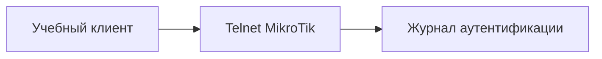

# Подбор паролей Telnet

## Схема

## Что сделал

- Воспроизвёл подбор пароля тестовой учётной записи Telnet на учебном MikroTik.
- Разобрал отказы и успешный вход в журнале аутентификации.
- Отключил учебный Telnet-доступ после проверки.
