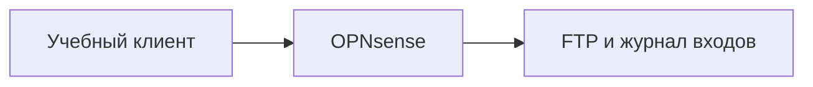

[Портфолио](../../../README.md) / [Сети](../README.md) / NET-17

# NET-17 · Password Spraying

> Отличить проверку одного пароля на множестве учётных записей от обычного brute-force.

| Формат | Исходный кейс | Основной фокус |
| :-- | :-- | :-- |
| Учебная практика | `824` | Сети |

## Стенд и схема

Debian и сетевые ВМ по схеме кейса. Адреса и имена интерфейсов в командах — примеры, их нужно сверить с фактической схемой.



Схема показывает логику лабораторной. Для точного повторения исходного кейса используются его адресный план, образы и версии компонентов. Подготовка среды описана в [руководстве по стендам](../../../docs/lab-environment.md).

## Ход работы

1. Подготовить изолированные клиентский и серверный сегменты через OPNsense.
2. Создать только учебные учётные записи и зафиксировать политику блокировки.
3. Воспроизвести ограниченный сценарий из кейса и собрать журнал FTP-сервера.
4. Сгруппировать отказы по источнику, пользователю и времени; сравнить с подбором одной учётной записи.

## Команды и контрольные проверки

```bash
journalctl --since "15 minutes ago"
ss -lntp
```

Это команды проверки или пример исправления, а не сохранённый вывод с выполненного стенда. Полный набор действий зависит от подготовленного образа и версии ПО.

## Как подтвердить результат

- Обезличенная таблица время / источник / учётная запись / результат.
- Политика блокировки и сравнение двух паттернов попыток входа.

Для фиксации фактического прогона используется [шаблон отчёта](../../../templates/run-report.md).

## Что важно для SOC

Небольшое число ошибок на каждого пользователя может скрывать массовую атаку. Нужна корреляция по нескольким учётным записям и временному окну.

## Защита и повторная проверка

Использовать MFA, запрет распространённых паролей, безопасную блокировку и мониторинг массовых отказов.

После изменения конфигурации повторяется исходная проверка: нужно подтвердить устранение причины и сохранение штатной функции, а не только исчезновение ошибки в интерфейсе.

<details>
<summary>Источник и границы разбора</summary>

Тема и порядок действий адаптированы из пользовательского архива **«пт.zip»**, файл `tasks/824_Self-study_Case_2.17_-_Password_Spraying.md`.
Это сжатый разбор учебной практики с добавленными схемой, критериями подтверждения и аналитическими пояснениями. Результаты чекеров и курсовые флаги не публикуются. Указания по официальной документации: [источники](../../../docs/sources.md).

</details>

---

[← Предыдущая](../16-telnet-bruteforce/README.md) · [Все лабораторные](../README.md) · [Следующая →](../18-log4shell-detection/README.md)
