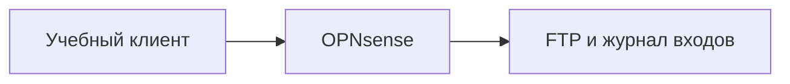

# Password Spraying

## Схема

## Что сделал

- Воспроизвёл Password Spraying на учебных учётных записях.
- Разобрал отказы входа по пользователям, источнику и времени и сравнил их с обычным brute-force.
