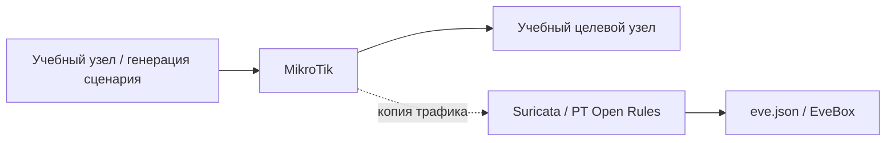

[Портфолио](../../../README.md) / [Сети](../README.md) / NET-18

# NET-18 · Log4Shell: сетевое обнаружение

> Связать учебный запрос Log4Shell с потоком и сработавшей сигнатурой Suricata.

| Формат | Исходный кейс | Основной фокус |
| :-- | :-- | :-- |
| Учебная практика | `825` | Сети |

## Стенд и схема

Debian и сетевые ВМ по схеме кейса. Адреса и имена интерфейсов в командах — примеры, их нужно сверить с фактической схемой.



Схема показывает логику лабораторной. Для точного повторения исходного кейса используются его адресный план, образы и версии компонентов. Подготовка среды описана в [руководстве по стендам](../../../docs/lab-environment.md).

## Ход работы

1. Подготовить Debian-клиент, учебное уязвимое приложение, MikroTik и сенсор Suricata.
2. Настроить зеркалирование трафика и проверить, что сенсор получает пакеты.
3. Подключить PT Open Rules и просмотр событий через EveBox.
4. Воспроизвести сценарий кейса, найти alert и сопоставить его с HTTP-запросом и исходным PCAP.

## Команды и контрольные проверки

```bash
sudo suricata -T -c /etc/suricata/suricata.yaml
jq -c 'select(.event_type == "alert") | {timestamp,src_ip,dest_ip,alert}' /var/log/suricata/eve.json
```

Это команды проверки или пример исправления, а не сохранённый вывод с выполненного стенда. Полный набор действий зависит от подготовленного образа и версии ПО.

## Как подтвердить результат

- Версия набора правил, SID/rev и время события.
- HTTP-запрос, связанный flow_id и запись EveBox без секретов.

Для фиксации фактического прогона используется [шаблон отчёта](../../../templates/run-report.md).

## Что важно для SOC

Сигнатура на характерную строку в запросе фиксирует попытку; успешную эксплуатацию нужно подтверждать отдельно по журналам приложения и исходящим соединениям.

## Защита и повторная проверка

Обновить уязвимые зависимости, ограничивать исходящие соединения приложения и дополнять сетевой детект наблюдением на хосте.

После изменения конфигурации повторяется исходная проверка: нужно подтвердить устранение причины и сохранение штатной функции, а не только исчезновение ошибки в интерфейсе.

<details>
<summary>Источник и границы разбора</summary>

Тема и порядок действий адаптированы из пользовательского архива **«пт.zip»**, файл `tasks/825_Guided_Case_2.18_-_Log4Shell.md`.
Это сжатый разбор учебной практики с добавленными схемой, критериями подтверждения и аналитическими пояснениями. Результаты чекеров и курсовые флаги не публикуются. Указания по официальной документации: [источники](../../../docs/sources.md).

</details>

---

[← Предыдущая](../17-password-spraying/README.md) · [Все лабораторные](../README.md) · [Следующая →](../19-telnet-auth-bypass/README.md)
