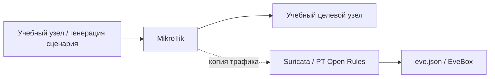

# Log4Shell: сетевое обнаружение

## Схема

## Что сделал

- Настроил зеркалирование трафика с MikroTik на Suricata, подключил PT Open Rules и EveBox.
- Воспроизвёл учебный сценарий Log4Shell.
- Сопоставил сработавшую сигнатуру с HTTP-запросом и сетевым потоком.
