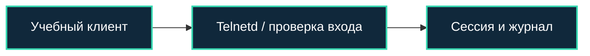

[Портфолио](../../../README.md) / [Сети](../README.md) / NET-19

# NET-19 · Telnetd Authentication Bypass

> Разобрать учебный обход аутентификации и отличить доступ к сервису от штатного входа.

| Формат | Исходный кейс | Основной фокус |
| :-- | :-- | :-- |
| Учебная практика PT Start | `826` | Сети |

## Стенд и схема

Debian и сетевые ВМ по схеме кейса. Адреса и имена интерфейсов в командах — примеры, их нужно сверить с фактической схемой.



Схема показывает логику лабораторной. Для точного повторения исходного кейса используются его адресный план, образы и версии компонентов. Подготовка среды описана в [руководстве по стендам](../../../docs/lab-environment.md).

## Ход работы

1. Подготовить ровно тот учебный образ и версию Telnetd, которые предусмотрены кейсом.
2. Зафиксировать доступность сервиса и контрольный вход.
3. Воспроизвести обход по заданию курса, сохранить последовательность действий и результат.
4. Сравнить журналы и сетевой обмен штатного и аномального входа, вернуть снимок стенда.

## Команды и контрольные проверки

```bash
ss -lntp
journalctl --since "15 minutes ago"
```

Это команды проверки или пример исправления, а не сохранённый вывод с выполненного стенда. Полный набор действий зависит от подготовленного образа и версии ПО.

## Как подтвердить результат

- Версия учебного сервиса, условия сценария и журнал подключения.
- Отдельное подтверждение контекста полученной сессии.

Для фиксации фактического прогона используется [шаблон отчёта](../../../templates/run-report.md).

## Что важно для SOC

Сессия без ожидаемой цепочки аутентификации требует проверки. Точный CVE и условия уязвимости нельзя выводить только из названия кейса.

## Защита и повторная проверка

Отказаться от Telnet, обновлять серверный компонент и ограничивать административные интерфейсы.

После изменения конфигурации повторяется исходная проверка: нужно подтвердить устранение причины и сохранение штатной функции, а не только исчезновение ошибки в интерфейсе.

<details>
<summary>Источник и границы разбора</summary>

Тема и порядок действий адаптированы из пользовательского архива **«пт.zip»**, файл `tasks/826_Self-study_Case_2.19_-_Telnetd_Authentication_Bypass.md`.
Это сжатый разбор учебной практики с добавленными схемой, критериями подтверждения и аналитическими пояснениями. Результаты чекеров и курсовые флаги не публикуются. Указания по официальной документации: [источники](../../../docs/sources.md).

</details>

---

[← Предыдущая](../18-log4shell-detection/README.md) · [Все лабораторные](../README.md) · [Следующая →](../20-reactshell/README.md)
