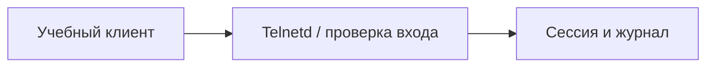

# Telnetd Authentication Bypass

## Схема

## Что сделал

- Воспроизвёл учебный сценарий обхода аутентификации Telnetd.
- Сравнил обычное и аномальное подключения по журналам и сетевому обмену.
- Восстановил исходный снимок стенда.
