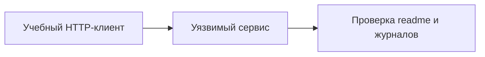

[Портфолио](../../../README.md) / [Сети](../README.md) / NET-20

# NET-20 · ReactShell: разбор учебного кейса

> Задокументировать сценарий эксплуатации учебного веб-сервиса и необходимые доказательства результата.

| Формат | Исходный кейс | Основной фокус |
| :-- | :-- | :-- |
| Учебная практика | `827` | Сети |

## Стенд и схема

Debian и сетевые ВМ по схеме кейса. Адреса и имена интерфейсов в командах — примеры, их нужно сверить с фактической схемой.



Схема показывает логику лабораторной. Для точного повторения исходного кейса используются его адресный план, образы и версии компонентов. Подготовка среды описана в [руководстве по стендам](../../../docs/lab-environment.md).

## Ход работы

1. Использовать уязвимый образ из кейса в отдельной внутренней сети.
2. Записать версии компонентов и исходное состояние сервиса.
3. Воспроизвести предусмотренную заданием последовательность и проверить доступ к тестовому readme.
4. Сопоставить запросы, ошибки приложения и изменения на хосте, затем восстановить снимок.

## Команды и контрольные проверки

```bash
date -u
ss -lntp
journalctl --since "15 minutes ago"
```

Это команды проверки или пример исправления, а не сохранённый вывод с выполненного стенда. Полный набор действий зависит от подготовленного образа и версии ПО.

## Как подтвердить результат

- Версия образа, HTTP-запрос и обезличенный результат проверки.
- Временная линия запроса и событий на сервере.

Для фиксации фактического прогона используется [шаблон отчёта](../../../templates/run-report.md).

## Что важно для SOC

Название ReactShell сохранено из архива. Конкретный CVE и механизм уязвимости устанавливать по версии приложения и техническим данным, а не по названию.

## Защита и повторная проверка

Обновлять зависимости, минимизировать привилегии приложения и вести журналы запросов и процессов.

После изменения конфигурации повторяется исходная проверка: нужно подтвердить устранение причины и сохранение штатной функции, а не только исчезновение ошибки в интерфейсе.

<details>
<summary>Источник и границы разбора</summary>

Тема и порядок действий адаптированы из пользовательского архива **«пт.zip»**, файл `tasks/827_Self-study_Case_2.20_-_ReactShell.md`.
Это сжатый разбор учебной практики с добавленными схемой, критериями подтверждения и аналитическими пояснениями. Результаты чекеров и курсовые флаги не публикуются. Указания по официальной документации: [источники](../../../docs/sources.md).

</details>

---

[← Предыдущая](../19-telnet-auth-bypass/README.md) · [Все лабораторные](../README.md) · [Следующая →](../21-meterpreter-detection/README.md)
