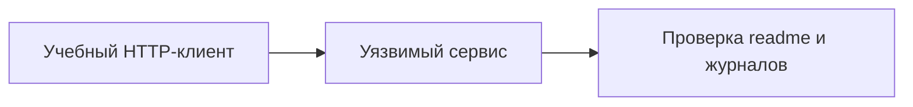

# ReactShell: разбор учебного кейса

## Схема

## Что сделал

- Воспроизвёл сценарий ReactShell на учебном уязвимом сервисе.
- Проверил доступ к тестовому readme и сопоставил запросы с событиями сервера.
- Восстановил исходное состояние стенда.
