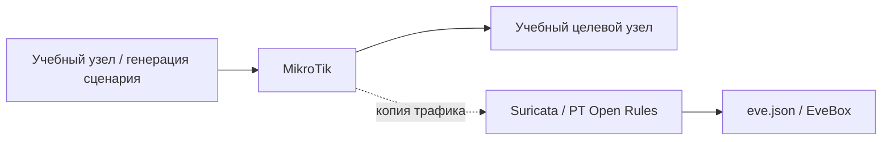

# Metasploit и обнаружение Meterpreter

## Схема

## Что сделал

- Воспроизвёл учебный сценарий Metasploit/Meterpreter в изолированной сети.
- Нашёл срабатывание Suricata в EveBox и разобрал сигнатуру и параметры потока.
