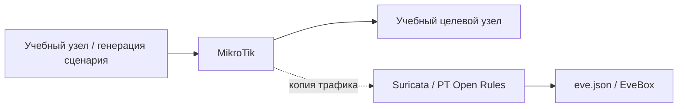

[Портфолио](../../../README.md) / [Сети](../README.md) / NET-21

# NET-21 · Metasploit и обнаружение Meterpreter

> Исследовать сетевое обнаружение первичного взаимодействия учебного агента с управляющим узлом.

| Формат | Исходный кейс | Основной фокус |
| :-- | :-- | :-- |
| Учебная практика | `828` | Сети |

## Стенд и схема

Debian и сетевые ВМ по схеме кейса. Адреса и имена интерфейсов в командах — примеры, их нужно сверить с фактической схемой.



Схема показывает логику лабораторной. Для точного повторения исходного кейса используются его адресный план, образы и версии компонентов. Подготовка среды описана в [руководстве по стендам](../../../docs/lab-environment.md).

## Ход работы

1. Подготовить изолированный стенд и сенсор Suricata с PT Open Rules.
2. Воспроизвести предусмотренный кейсом сценарий Meterpreter только на учебных ВМ.
3. Найти сработавшее правило в EveBox и записать SID, направление и параметры потока.
4. Объяснить, какие признаки использует правило и чем подтверждается взаимодействие на хосте.

## Команды и контрольные проверки

```bash
jq -c 'select(.event_type == "alert") | {timestamp,flow_id,src_ip,src_port,dest_ip,dest_port,alert}' /var/log/suricata/eve.json
```

Это команды проверки или пример исправления, а не сохранённый вывод с выполненного стенда. Полный набор действий зависит от подготовленного образа и версии ПО.

## Как подтвердить результат

- Alert, связанный поток и версия сигнатуры.
- Обезличенная временная линия сетевого и хостового события.

Для фиксации фактического прогона используется [шаблон отчёта](../../../templates/run-report.md).

## Что важно для SOC

SID не гарантирует обнаружение всех вариантов фреймворка. Значение allowed в IDS-сценарии не означает блокировку; проверять фактический режим и вердикт.

## Защита и повторная проверка

Ограничивать исходящие соединения, использовать хостовый мониторинг и проверять полноту видимости сенсора.

После изменения конфигурации повторяется исходная проверка: нужно подтвердить устранение причины и сохранение штатной функции, а не только исчезновение ошибки в интерфейсе.

<details>
<summary>Источник и границы разбора</summary>

Тема и порядок действий адаптированы из пользовательского архива **«пт.zip»**, файл `tasks/828_Guided_Case_2.21_-_Metasploit.md`.
Это сжатый разбор учебной практики с добавленными схемой, критериями подтверждения и аналитическими пояснениями. Результаты чекеров и курсовые флаги не публикуются. Указания по официальной документации: [источники](../../../docs/sources.md).

</details>

---

[← Предыдущая](../20-reactshell/README.md) · [Все лабораторные](../README.md) · [Следующая →](../22-adaptix-detection/README.md)
