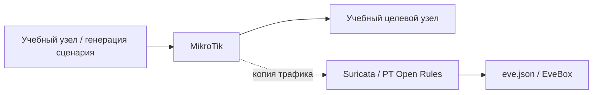

# Adaptix: обнаружение сетевой активности

## Схема

## Что сделал

- Воспроизвёл учебный сценарий взаимодействия агента Adaptix с управляющим узлом.
- Разобрал срабатывание Suricata, направление обмена и признаки, используемые правилом.
