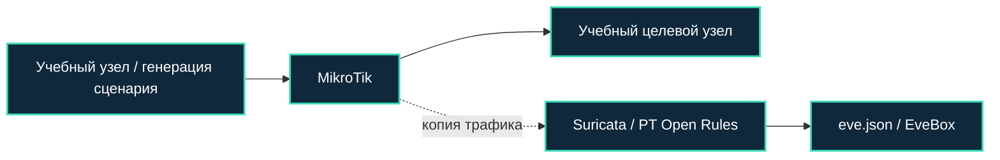

[Портфолио](../../../README.md) / [Сети](../README.md) / NET-22

# NET-22 · Adaptix: обнаружение сетевой активности

> Разобрать сигнатурное обнаружение первичного обмена учебного агента Adaptix.

| Формат | Исходный кейс | Основной фокус |
| :-- | :-- | :-- |
| Учебная практика PT Start | `829` | Сети |

## Стенд и схема

Debian и сетевые ВМ по схеме кейса. Адреса и имена интерфейсов в командах — примеры, их нужно сверить с фактической схемой.



Схема показывает логику лабораторной. Для точного повторения исходного кейса используются его адресный план, образы и версии компонентов. Подготовка среды описана в [руководстве по стендам](../../../docs/lab-environment.md).

## Ход работы

1. Подготовить учебные узлы и проверить доставку трафика на Suricata.
2. Воспроизвести сценарий курса и найти соответствующий alert в EveBox.
3. Сопоставить направление обмена, размеры пакетов и начальный баннер с условиями правила.
4. Описать ограничения детекта при изменении профиля связи.

## Команды и контрольные проверки

```bash
jq -c 'select(.event_type == "alert") | {timestamp,flow_id,src_ip,dest_ip,alert}' /var/log/suricata/eve.json
```

Это команды проверки или пример исправления, а не сохранённый вывод с выполненного стенда. Полный набор действий зависит от подготовленного образа и версии ПО.

## Как подтвердить результат

- Сработавшая сигнатура с SID/rev и релевантный участок PCAP.
- Пояснение признаков правила без утверждения о полном покрытии инструмента.

Для фиксации фактического прогона используется [шаблон отчёта](../../../templates/run-report.md).

## Что важно для SOC

Нужно отличать обнаружение конкретного сетевого паттерна от доказательства всех действий агента. Подтверждать вывод событиями на хосте.

## Защита и повторная проверка

Ограничивать C2-связь политиками egress, контролировать процессы и обновлять правила обнаружения.

После изменения конфигурации повторяется исходная проверка: нужно подтвердить устранение причины и сохранение штатной функции, а не только исчезновение ошибки в интерфейсе.

<details>
<summary>Источник и границы разбора</summary>

Тема и порядок действий адаптированы из пользовательского архива **«пт.zip»**, файл `tasks/829_Guided_Case_2.22_-_Adaptix.md`.
Это сжатый разбор учебной практики с добавленными схемой, критериями подтверждения и аналитическими пояснениями. Результаты чекеров и курсовые флаги не публикуются. Указания по официальной документации: [источники](../../../docs/sources.md).

</details>

---

[← Предыдущая](../21-meterpreter-detection/README.md) · [Все лабораторные](../README.md) · [Следующая →](../23-sliver-detection/README.md)
