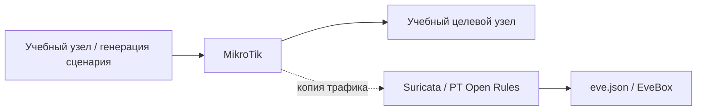

[Портфолио](../../../README.md) / [Сети](../README.md) / NET-23

# NET-23 · Sliver: обнаружение HTTP-обмена

> Разобрать признаки HTTP-обмена учебного Sliver-агента и маскировки под обычный веб-трафик.

| Формат | Исходный кейс | Основной фокус |
| :-- | :-- | :-- |
| Учебная практика | `830` | Сети |

## Стенд и схема

Debian и сетевые ВМ по схеме кейса. Адреса и имена интерфейсов в командах — примеры, их нужно сверить с фактической схемой.



Схема показывает логику лабораторной. Для точного повторения исходного кейса используются его адресный план, образы и версии компонентов. Подготовка среды описана в [руководстве по стендам](../../../docs/lab-environment.md).

## Ход работы

1. Подготовить изолированную схему из кейса с сенсором Suricata.
2. Воспроизвести учебное подключение и найти срабатывание PT Open Rules.
3. Рассмотреть URI, метод, заголовки и формат тела запроса.
4. Сопоставить HTTP-событие с alert и описать, почему похожий на браузер User-Agent сам по себе не доказывает легитимность.

## Команды и контрольные проверки

```bash
jq -c 'select(.event_type == "alert" or .event_type == "http") | {timestamp,event_type,flow_id,http,alert}' /var/log/suricata/eve.json
```

Это команды проверки или пример исправления, а не сохранённый вывод с выполненного стенда. Полный набор действий зависит от подготовленного образа и версии ПО.

## Как подтвердить результат

- Связанные HTTP/alert-события и SID/rev.
- Краткий разбор метаданных запроса и ограничений анализа шифрованного трафика.

Для фиксации фактического прогона используется [шаблон отчёта](../../../templates/run-report.md).

## Что важно для SOC

Сопоставлять несколько признаков и данные хоста. При TLS без расшифрования сенсор не видит произвольный HTTP payload; доступная телеметрия зависит от точки наблюдения.

## Защита и повторная проверка

Контролировать egress и запуск процессов, сохранять сетевые метаданные и тестировать правила на своей версии сценария.

После изменения конфигурации повторяется исходная проверка: нужно подтвердить устранение причины и сохранение штатной функции, а не только исчезновение ошибки в интерфейсе.

<details>
<summary>Источник и границы разбора</summary>

Тема и порядок действий адаптированы из пользовательского архива **«пт.zip»**, файл `tasks/830_Guided_Case_2.23_-_Sliver.md`.
Это сжатый разбор учебной практики с добавленными схемой, критериями подтверждения и аналитическими пояснениями. Результаты чекеров и курсовые флаги не публикуются. Указания по официальной документации: [источники](../../../docs/sources.md).

</details>

---

[← Предыдущая](../22-adaptix-detection/README.md) · [Все лабораторные](../README.md)
