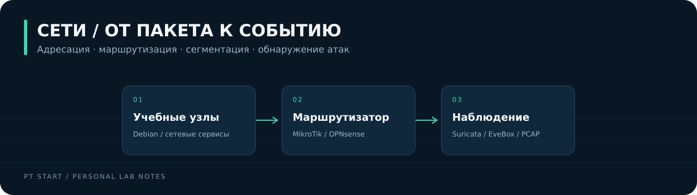

[← На главную](../../README.md)

# Сети и сетевая безопасность

От адресного плана до разбора сетевых срабатываний IDS. В разделе **23 лабораторных** из архива PT Start.

| Лабораторная | Тема | ID исходного кейса |
| :-- | :-- | :-- |
| [NET-01](01-static-addressing/README.md) | [Статическая адресация](01-static-addressing/README.md) | `811` |
| [NET-02](02-subnet-masks/README.md) | [Маски подсетей и VLSM](02-subnet-masks/README.md) | `812` |
| [NET-03](03-dhcp/README.md) | [Динамическая адресация DHCP](03-dhcp/README.md) | `813` |
| [NET-04](04-static-routing/README.md) | [Статическая маршрутизация](04-static-routing/README.md) | `814` |
| [NET-05](05-ospf/README.md) | [Динамическая маршрутизация OSPF](05-ospf/README.md) | `815` |
| [NET-06](06-dns/README.md) | [DNS и разрешение имён](06-dns/README.md) | `746` |
| [NET-07](07-vlan/README.md) | [VLAN и сегментация](07-vlan/README.md) | `748` |
| [NET-08](08-nat/README.md) | [NAT и публикация сервисов](08-nat/README.md) | `749` |
| [NET-09](09-openvpn/README.md) | [OpenVPN и доступ во внутреннюю сеть](09-openvpn/README.md) | `816` |
| [NET-10](10-3proxy/README.md) | [3proxy и контроль проксируемого доступа](10-3proxy/README.md) | `817` |
| [NET-11](11-arp-spoofing/README.md) | [ARP Spoofing и признаки MITM](11-arp-spoofing/README.md) | `818` |
| [NET-12](12-rogue-dhcp/README.md) | [DHCP Starvation и Rogue DHCP](12-rogue-dhcp/README.md) | `819` |
| [NET-13](13-icmp-discovery/README.md) | [ICMP и обнаружение узлов](13-icmp-discovery/README.md) | `820` |
| [NET-14](14-udp-scanning/README.md) | [UDP-сканирование](14-udp-scanning/README.md) | `821` |
| [NET-15](15-tcp-scanning/README.md) | [TCP-сканирование и состояния портов](15-tcp-scanning/README.md) | `822` |
| [NET-16](16-telnet-bruteforce/README.md) | [Подбор паролей Telnet](16-telnet-bruteforce/README.md) | `823` |
| [NET-17](17-password-spraying/README.md) | [Password Spraying](17-password-spraying/README.md) | `824` |
| [NET-18](18-log4shell-detection/README.md) | [Log4Shell: сетевое обнаружение](18-log4shell-detection/README.md) | `825` |
| [NET-19](19-telnet-auth-bypass/README.md) | [Telnetd Authentication Bypass](19-telnet-auth-bypass/README.md) | `826` |
| [NET-20](20-reactshell/README.md) | [ReactShell: разбор учебного кейса](20-reactshell/README.md) | `827` |
| [NET-21](21-meterpreter-detection/README.md) | [Metasploit и обнаружение Meterpreter](21-meterpreter-detection/README.md) | `828` |
| [NET-22](22-adaptix-detection/README.md) | [Adaptix: обнаружение сетевой активности](22-adaptix-detection/README.md) | `829` |
| [NET-23](23-sliver-detection/README.md) | [Sliver: обнаружение HTTP-обмена](23-sliver-detection/README.md) | `830` |

## Как читать разборы

В каждом кейсе: цель → схема → ход работы → контрольные команды → доказательства результата → взгляд SOC → защита.

Шаги описывают воспроизведение на учебных ВМ. Фактические версии и результаты собственного прогона фиксируются отдельно: [шаблон отчёта](../../templates/run-report.md).
