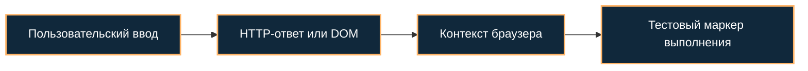

[Портфолио](../../../README.md) / [Web / OWASP](../README.md) / WEB-02

# WEB-02 · XSS: отражённый и сохранённый ввод

> Проверить, попадает ли пользовательский ввод в исполняемый контекст браузера.

| Формат | Исходный кейс | Основной фокус |
| :-- | :-- | :-- |
| Учебная практика PT Start | `888` | Web / OWASP |

**Привязка к OWASP:** A05:2025 Injection.

## Стенд и схема

Учебное приложение и компоненты соответствующего кейса PT Start. URL, параметры и пути необходимо брать из своего стенда; примеры ниже поясняют проверку или исправление.



Схема показывает логику лабораторной. Для точного повторения исходного кейса используются его адресный план, образы и версии компонентов. Подготовка среды описана в [руководстве по стендам](../../../docs/lab-environment.md).

## Ход работы

1. Выбрать предусмотренную кейсом форму и отправить уникальный текстовый маркер.
2. Проверить, где маркер появился: HTML, атрибут, JavaScript или DOM.
3. На локальном стенде применить безвредный маркер выполнения и определить, отражается ли ввод сразу или сохраняется.
4. Сравнить поведение после контекстного экранирования; учесть сохранённые значения.

## Команды и контрольные проверки

```text
Текстовый маркер: LAB-XSS-01
Для разрешённого учебного HTML-контекста: <script>console.log('LAB-XSS-01')</script>
Проверить DOM, console и сырой HTTP-ответ, не только визуальное отображение.
```

Это команды проверки или пример исправления, а не сохранённый вывод с выполненного стенда. Полный набор действий зависит от подготовленного образа и версии ПО.

## Как подтвердить результат

- Запрос, контекст вставки и подтверждение выполнения в учебном браузере.
- Ответ после исправления и способ обработки ранее сохранённого ввода.

Для фиксации фактического прогона используется [шаблон отчёта](../../../templates/run-report.md).

## Что важно для SOC

Отражение строки не равно выполнению JavaScript. CSP и тип вставки меняют результат; серверный access log не показывает все DOM-based сценарии.

## Защита и повторная проверка

Применять контекстное кодирование и безопасные DOM API, избегать небезопасного HTML, использовать CSP как дополнительный слой.

После изменения конфигурации повторяется исходная проверка: нужно подтвердить устранение причины и сохранение штатной функции, а не только исчезновение ошибки в интерфейсе.

<details>
<summary>Источник и границы разбора</summary>

Тема и порядок действий адаптированы из пользовательского архива **«пт.zip»**, файл `tasks/888_Guided_Case_4.2_-_Эксплуатация_XSS.md`.
Это сжатый разбор учебной практики с добавленными схемой, критериями подтверждения и аналитическими пояснениями. Результаты чекеров и курсовые флаги не публикуются. Указания по официальной документации: [источники](../../../docs/sources.md).

</details>

---

[← Предыдущая](../01-burp-http/README.md) · [Все лабораторные](../README.md) · [Следующая →](../03-sql-injection/README.md)
