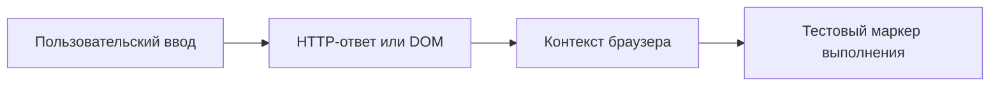

# XSS: отражённый и сохранённый ввод

## Схема

## Что сделал

- Проверил обработку пользовательского ввода и воспроизвёл XSS на учебном приложении.
- Разобрал контекст вставки и выполнение тестового JavaScript в браузере.
