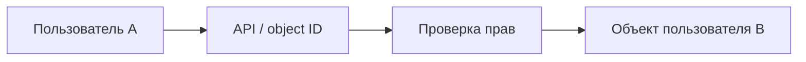

[Портфолио](../../../README.md) / [Web / OWASP](../README.md) / WEB-04

# WEB-04 · IDOR и объектная авторизация

> Проверить доступ к чужому объекту под обычной учётной записью.

| Формат | Исходный кейс | Основной фокус |
| :-- | :-- | :-- |
| Учебная практика | `892` | Web / OWASP |

**Привязка к OWASP:** A01:2025 Broken Access Control.

## Стенд и схема

Учебное приложение и компоненты соответствующего учебного кейса. URL, параметры и пути необходимо брать из своего стенда; примеры ниже поясняют проверку или исправление.



Схема показывает логику лабораторной. Для точного повторения исходного кейса используются его адресный план, образы и версии компонентов. Подготовка среды описана в [руководстве по стендам](../../../docs/lab-environment.md).

## Ход работы

1. Создать двух учебных пользователей и по одному объекту каждого.
2. Получить штатный запрос пользователя A к своему объекту.
3. Изменить только идентификатор на объект B, сохранив сессию A.
4. Проверить чтение и изменение отдельно, не ограничиваясь скрытием кнопок.
5. Добавить серверную проверку владения или разрешения и повторить матрицу доступа.

## Команды и контрольные проверки

```text
Матрица проверки:
A → объект A: разрешено
B → объект B: разрешено
A → объект B: отказ по принятой модели доступа
Неавторизованный клиент → приватный объект: отказ
```

Это команды проверки или пример исправления, а не сохранённый вывод с выполненного стенда. Полный набор действий зависит от подготовленного образа и версии ПО.

## Как подтвердить результат

- Матрица субъект / объект / действие / результат.
- Запрос от A и ответ сервера до и после исправления без session cookie.

Для фиксации фактического прогона используется [шаблон отчёта](../../../templates/run-report.md).

## Что важно для SOC

Последовательный обход object ID может указывать на поиск IDOR. Для анализа логов нужны субъект, объект и результат серверной авторизации.

## Защита и повторная проверка

Проверять права на каждый объект и действие на сервере. Случайные идентификаторы усложняют перебор, но не заменяют авторизацию.

После изменения конфигурации повторяется исходная проверка: нужно подтвердить устранение причины и сохранение штатной функции, а не только исчезновение ошибки в интерфейсе.

<details>
<summary>Источник и границы разбора</summary>

Тема и порядок действий адаптированы из пользовательского архива **«пт.zip»**, файл `tasks/892_Guided_Case_4.4_-_Эксплуатация_IDOR.md`.
Это сжатый разбор учебной практики с добавленными схемой, критериями подтверждения и аналитическими пояснениями. Результаты чекеров и курсовые флаги не публикуются. Указания по официальной документации: [источники](../../../docs/sources.md).

</details>

---

[← Предыдущая](../03-sql-injection/README.md) · [Все лабораторные](../README.md) · [Следующая →](../05-lfi/README.md)
