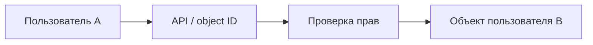

# IDOR и объектная авторизация

## Схема

## Что сделал

- Проверил доступ к объектам двух учебных пользователей и воспроизвёл IDOR.
- Проверил доступ к чужому объекту при изменении его идентификатора в запросе.
