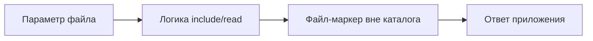

[Портфолио](../../../README.md) / [Web / OWASP](../README.md) / WEB-05

# WEB-05 · LFI: небезопасное подключение файлов

> Отличить подключение файла от обычной выдачи документа и проверить границу допустимых путей.

| Формат | Исходный кейс | Основной фокус |
| :-- | :-- | :-- |
| Учебная практика | `894` | Web / OWASP |

**Привязка к OWASP:** A01:2025 Broken Access Control — если первопричина в выходе за разрешённую границу.

## Стенд и схема

Учебное приложение и компоненты соответствующего учебного кейса. URL, параметры и пути необходимо брать из своего стенда; примеры ниже поясняют проверку или исправление.



Схема показывает логику лабораторной. Для точного повторения исходного кейса используются его адресный план, образы и версии компонентов. Подготовка среды описана в [руководстве по стендам](../../../docs/lab-environment.md).

## Ход работы

1. Выявить параметр выбора файла или шаблона в учебном приложении.
2. Подготовить безвредный файл-маркер вне разрешённого каталога.
3. Проверить возможность обратиться к нему через пользовательский путь.
4. Сопоставить ответ с логикой include/read и определить реальную первопричину.
5. Заменить свободный путь отображением разрешённых идентификаторов на заранее заданные файлы.

## Команды и контрольные проверки

```text
Файл-маркер: LAB-LFI-01
В отчёте записать параметр, допустимый каталог, полученный канонический путь и контекст подключения.
Не считать любую выдачу файла доказательством выполнения кода.
```

Это команды проверки или пример исправления, а не сохранённый вывод с выполненного стенда. Полный набор действий зависит от подготовленного образа и версии ПО.

## Как подтвердить результат

- Запрос, путь к синтетическому маркеру и результат.
- Фрагмент безопасного выбора файла и повторная проверка.

Для фиксации фактического прогона используется [шаблон отчёта](../../../templates/run-report.md).

## Что важно для SOC

Искать попытки выхода за каталог и неожиданные ошибки include/open. Успешное чтение и исполнение кода — разные результаты, требующие разных доказательств.

## Защита и повторная проверка

Использовать allowlist идентификаторов, ограничение файлового доступа и минимальные права процесса.

После изменения конфигурации повторяется исходная проверка: нужно подтвердить устранение причины и сохранение штатной функции, а не только исчезновение ошибки в интерфейсе.

<details>
<summary>Источник и границы разбора</summary>

Тема и порядок действий адаптированы из пользовательского архива **«пт.zip»**, файл `tasks/894_Guided_Case_4.5_-_Эксплуатация_LFI.md`.
Это сжатый разбор учебной практики с добавленными схемой, критериями подтверждения и аналитическими пояснениями. Результаты чекеров и курсовые флаги не публикуются. Указания по официальной документации: [источники](../../../docs/sources.md).

</details>

---

[← Предыдущая](../04-idor/README.md) · [Все лабораторные](../README.md) · [Следующая →](../06-directory-traversal/README.md)
