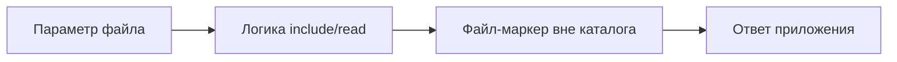

# LFI: небезопасное подключение файлов

## Схема

## Что сделал

- Проверил выбор файлов через пользовательский параметр и воспроизвёл LFI.
- Проверил доступ к локальному файлу через уязвимый параметр.
- Разобрал причину небезопасной обработки пути к файлу.
