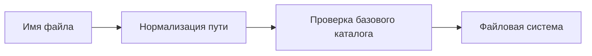

# Directory Traversal

## Схема

## Что сделал

- Воспроизвёл Directory Traversal на учебном endpoint выдачи файлов.
- Проверил нормализацию пути и ограничение базовым каталогом.
- Разобрал выход за пределы разрешённого каталога.
