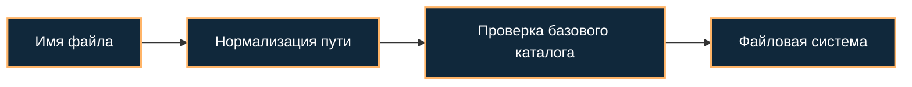

[Портфолио](../../../README.md) / [Web / OWASP](../README.md) / WEB-06

# WEB-06 · Directory Traversal

> Проверить, сохраняется ли ограничение базовым каталогом после нормализации пути.

| Формат | Исходный кейс | Основной фокус |
| :-- | :-- | :-- |
| Учебная практика PT Start | `896` | Web / OWASP |

**Привязка к OWASP:** A01:2025 Broken Access Control.

## Стенд и схема

Учебное приложение и компоненты соответствующего кейса PT Start. URL, параметры и пути необходимо брать из своего стенда; примеры ниже поясняют проверку или исправление.



Схема показывает логику лабораторной. Для точного повторения исходного кейса используются его адресный план, образы и версии компонентов. Подготовка среды описана в [руководстве по стендам](../../../docs/lab-environment.md).

## Ход работы

1. Найти учебный endpoint выдачи файлов и записать базовый каталог.
2. Создать тестовый файл за его пределами.
3. Проверить варианты перехода к родительскому каталогу и кодирования на локальном стенде.
4. Сравнить пользовательскую строку с каноническим путём и проверить границу через операции с путями.
5. Повторить проверку после исправления и учесть символьные ссылки и гонки файловой системы.

## Команды и контрольные проверки

```python
from pathlib import Path
base = Path('/srv/lab/files').resolve()
candidate = (base / supplied_name).resolve()
if not candidate.is_relative_to(base):
    raise PermissionError('Outside allowed directory')
# Это проверка границы; полная защита также учитывает symlink/TOCTOU.
```

Это команды проверки или пример исправления, а не сохранённый вывод с выполненного стенда. Полный набор действий зависит от подготовленного образа и версии ПО.

## Как подтвердить результат

- Исходный запрос, нормализованный путь и доступ к тестовому маркеру.
- Проверки после исправления, включая вложенные пути.

Для фиксации фактического прогона используется [шаблон отчёта](../../../templates/run-report.md).

## Что важно для SOC

Подстрока ../ — индикатор для проверки, но вход может быть закодирован. Проверка строковым startswith ненадёжна для границ каталогов.

## Защита и повторная проверка

Предпочитать allowlist файлов, каноникализацию с проверкой принадлежности каталогу и безопасное открытие файлов при недоверенной файловой системе.

После изменения конфигурации повторяется исходная проверка: нужно подтвердить устранение причины и сохранение штатной функции, а не только исчезновение ошибки в интерфейсе.

<details>
<summary>Источник и границы разбора</summary>

Тема и порядок действий адаптированы из пользовательского архива **«пт.zip»**, файл `tasks/896_Guided_Case_4.6_-_Эксплуатация_Directory_Traversal.md`.
Это сжатый разбор учебной практики с добавленными схемой, критериями подтверждения и аналитическими пояснениями. Результаты чекеров и курсовые флаги не публикуются. Указания по официальной документации: [источники](../../../docs/sources.md).

</details>

---

[← Предыдущая](../05-lfi/README.md) · [Все лабораторные](../README.md) · [Следующая →](../07-command-injection/README.md)
