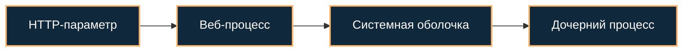

[Портфолио](../../../README.md) / [Web / OWASP](../README.md) / WEB-07

# WEB-07 · Command Injection

> Проверить, передаётся ли пользовательский ввод системной оболочке.

| Формат | Исходный кейс | Основной фокус |
| :-- | :-- | :-- |
| Учебная практика PT Start | `898` | Web / OWASP |

**Привязка к OWASP:** A05:2025 Injection.

## Стенд и схема

Учебное приложение и компоненты соответствующего кейса PT Start. URL, параметры и пути необходимо брать из своего стенда; примеры ниже поясняют проверку или исправление.



Схема показывает логику лабораторной. Для точного повторения исходного кейса используются его адресный план, образы и версии компонентов. Подготовка среды описана в [руководстве по стендам](../../../docs/lab-environment.md).

## Ход работы

1. Найти функцию учебного приложения, запускающую системную команду.
2. Сохранить нормальный запрос и результат.
3. На стенде проверить влияние разделителя команд с безвредным выводом маркера.
4. Сопоставить запрос с созданием дочернего процесса.
5. Заменить оболочку вызовом с фиксированными аргументами, allowlist допустимых значений и ограничением времени.

## Команды и контрольные проверки

```python
import subprocess
# Фиксированные программа и аргументы; пользовательский ввод валидируется отдельно.
result = subprocess.run(
    ['ping', '-c', '1', '127.0.0.1'],
    shell=False, capture_output=True, text=True, timeout=3
)
```

Это команды проверки или пример исправления, а не сохранённый вывод с выполненного стенда. Полный набор действий зависит от подготовленного образа и версии ПО.

## Как подтвердить результат

- HTTP-запрос, безопасный маркер и цепочка процессов.
- Исправленный вызов и повторение исходной проверки.

Для фиксации фактического прогона используется [шаблон отчёта](../../../templates/run-report.md).

## Что важно для SOC

Процесс оболочки, запущенный веб-сервером, требует проверки. Важны родительский процесс, командная строка, пользователь и время HTTP-запроса.

## Защита и повторная проверка

Предпочитать библиотечные API вместо shell, фиксировать исполняемый файл и проверять аргументы. shell=False не устраняет все опасные аргументы сам по себе.

После изменения конфигурации повторяется исходная проверка: нужно подтвердить устранение причины и сохранение штатной функции, а не только исчезновение ошибки в интерфейсе.

<details>
<summary>Источник и границы разбора</summary>

Тема и порядок действий адаптированы из пользовательского архива **«пт.zip»**, файл `tasks/898_Guided_Case_4.7_-_Эксплуатация_Command_Injection.md`.
Это сжатый разбор учебной практики с добавленными схемой, критериями подтверждения и аналитическими пояснениями. Результаты чекеров и курсовые флаги не публикуются. Указания по официальной документации: [источники](../../../docs/sources.md).

</details>

---

[← Предыдущая](../06-directory-traversal/README.md) · [Все лабораторные](../README.md) · [Следующая →](../08-code-injection/README.md)
