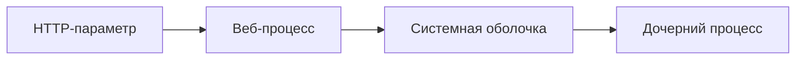

# Command Injection

## Схема

## Что сделал

- Воспроизвёл Command Injection на учебном приложении.
- Проверил выполнение системной команды через уязвимый параметр.
- Разобрал передачу пользовательского ввода в системную оболочку.
