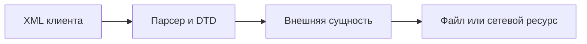

# XXE и настройки XML-парсера

## Схема

## Что сделал

- Воспроизвёл XXE на учебном XML-обработчике.
- Проверил настройки DTD и внешних сущностей XML-парсера.
- Проверил обращение XML-парсера к локальным файлам.
