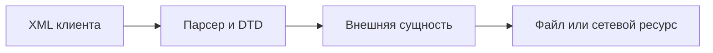

[Портфолио](../../../README.md) / [Web / OWASP](../README.md) / WEB-09

# WEB-09 · XXE и настройки XML-парсера

> Проверить обработку внешних сущностей и ограничить доступ XML-парсера к файлам и сети.

| Формат | Исходный кейс | Основной фокус |
| :-- | :-- | :-- |
| Учебная практика | `902` | Web / OWASP |

**Привязка к OWASP:** A02:2025 Security Misconfiguration — небезопасная конфигурация XML-парсера.

## Стенд и схема

Учебное приложение и компоненты соответствующего учебного кейса. URL, параметры и пути необходимо брать из своего стенда; примеры ниже поясняют проверку или исправление.



Схема показывает логику лабораторной. Для точного повторения исходного кейса используются его адресный план, образы и версии компонентов. Подготовка среды описана в [руководстве по стендам](../../../docs/lab-environment.md).

## Ход работы

1. Сохранить корректный XML-запрос учебного приложения.
2. Создать локальный файл-маркер и проверить обработку внешней сущности только на стенде.
3. Установить, разрешены ли DTD, разрешение сущностей и внешние обращения.
4. Отключить ненужные возможности парсера и проверить сохранение штатного функционала.
5. Повторить тест; отдельно проверить внешние DTD и entity expansion.

## Команды и контрольные проверки

```python
from lxml import etree
parser = etree.XMLParser(
    resolve_entities=False, load_dtd=False, no_network=True
)
root = etree.fromstring(xml_bytes, parser=parser)
# Конфигурация относится к lxml; для других парсеров параметры отличаются.
```

Это команды проверки или пример исправления, а не сохранённый вывод с выполненного стенда. Полный набор действий зависит от подготовленного образа и версии ПО.

## Как подтвердить результат

- XML-запрос, безопасный маркер и настройки конкретного парсера.
- Повторная проверка штатного XML и запрещённых внешних сущностей.

Для фиксации фактического прогона используется [шаблон отчёта](../../../templates/run-report.md).

## Что важно для SOC

Обращение XML-парсера к неожиданным файлам или адресам требует проверки. no_network не означает запрет всех локальных файловых операций.

## Защита и повторная проверка

Отключать DTD и внешние сущности, ограничивать ресурсы и права приложения; выбирать настройки для конкретной библиотеки.

После изменения конфигурации повторяется исходная проверка: нужно подтвердить устранение причины и сохранение штатной функции, а не только исчезновение ошибки в интерфейсе.

<details>
<summary>Источник и границы разбора</summary>

Тема и порядок действий адаптированы из пользовательского архива **«пт.zip»**, файл `tasks/902_Guided_Case_4.9_-_Эксплуатация_XXE.md`.
Это сжатый разбор учебной практики с добавленными схемой, критериями подтверждения и аналитическими пояснениями. Результаты чекеров и курсовые флаги не публикуются. Указания по официальной документации: [источники](../../../docs/sources.md).

</details>

---

[← Предыдущая](../08-code-injection/README.md) · [Все лабораторные](../README.md) · [Следующая →](../10-ssti/README.md)
