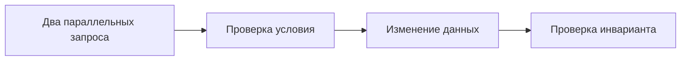

[Портфолио](../../../README.md) / [Web / OWASP](../README.md) / WEB-11

# WEB-11 · Race Condition и атомарность операции

> Проверить бизнес-инвариант при одновременной обработке запросов.

| Формат | Исходный кейс | Основной фокус |
| :-- | :-- | :-- |
| Учебная практика | `906` | Web / OWASP |

**Привязка к OWASP:** A06:2025 Insecure Design — нарушение бизнес-инварианта.

## Стенд и схема

Учебное приложение и компоненты соответствующего учебного кейса. URL, параметры и пути необходимо брать из своего стенда; примеры ниже поясняют проверку или исправление.



Схема показывает логику лабораторной. Для точного повторения исходного кейса используются его адресный план, образы и версии компонентов. Подготовка среды описана в [руководстве по стендам](../../../docs/lab-environment.md).

## Ход работы

1. Выбрать предусмотренную кейсом операцию с одноразовым или ограниченным действием.
2. Записать исходное состояние и выполнить последовательные контрольные запросы.
3. Отправить два синхронизированных запроса в учебной среде.
4. Сопоставить ответы с фактическим состоянием данных и журналом транзакций.
5. Добавить атомарное изменение, ограничение БД или блокировку и повторить параллельную проверку.

## Команды и контрольные проверки

```sql
-- Пример атомарной проверки одноразового действия; синтаксис PostgreSQL.
UPDATE coupons
SET used = TRUE
WHERE id = $1 AND used = FALSE
RETURNING id;
-- Успех определяется наличием изменённой строки, не только HTTP-статусом.
```

Это команды проверки или пример исправления, а не сохранённый вывод с выполненного стенда. Полный набор действий зависит от подготовленного образа и версии ПО.

## Как подтвердить результат

- Два запроса с временем отправки и ответами.
- Проверка инварианта в БД до/после исправления.

Для фиксации фактического прогона используется [шаблон отчёта](../../../templates/run-report.md).

## Что важно для SOC

Два ответа 200 не доказывают двойное выполнение. Нужен итоговый баланс, счётчик или другое состояние бизнес-объекта.

## Защита и повторная проверка

Применять атомарные операции, транзакции и ограничения БД. Idempotency key решает задачу повторов только при корректной серверной реализации.

После изменения конфигурации повторяется исходная проверка: нужно подтвердить устранение причины и сохранение штатной функции, а не только исчезновение ошибки в интерфейсе.

<details>
<summary>Источник и границы разбора</summary>

Тема и порядок действий адаптированы из пользовательского архива **«пт.zip»**, файл `tasks/906_Guided_Case_4.11_-_Эксплуатация_Race_Condition.md`.
Это сжатый разбор учебной практики с добавленными схемой, критериями подтверждения и аналитическими пояснениями. Результаты чекеров и курсовые флаги не публикуются. Указания по официальной документации: [источники](../../../docs/sources.md).

</details>

---

[← Предыдущая](../10-ssti/README.md) · [Все лабораторные](../README.md) · [Следующая →](../12-defectdojo/README.md)
