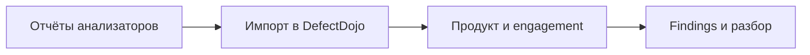

# DefectDojo: учёт результатов проверок

## Схема

## Что сделал

- Развернул DefectDojo с Docker Compose.
- Создал продукт NetTool и engagement для результатов статического анализа.
- Проверил состояние сервисов и готовность импорта отчётов.
