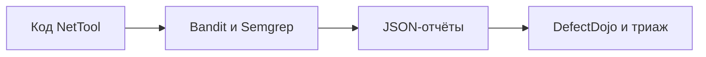

# Bandit и Semgrep: SAST и импорт результатов

## Схема

## Что сделал

- Запустил Bandit и Semgrep на учебном Python-приложении и сохранил JSON-отчёты.
- Импортировал результаты в DefectDojo.
- Сопоставил находки анализаторов и разобрал дубли и различия покрытия.
