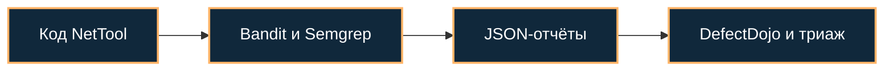

[Портфолио](../../../README.md) / [Web / OWASP](../README.md) / WEB-13

# WEB-13 · Bandit и Semgrep: SAST и импорт результатов

> Сравнить находки двух анализаторов на учебном Python-приложении и собрать их в DefectDojo.

| Формат | Исходный кейс | Основной фокус |
| :-- | :-- | :-- |
| Учебная практика PT Start | `909` | Web / OWASP |

**Привязка к OWASP:** A05:2025 Injection и A02:2025 Security Misconfiguration — по конкретной находке.

## Стенд и схема

Учебное приложение и компоненты соответствующего кейса PT Start. URL, параметры и пути необходимо брать из своего стенда; примеры ниже поясняют проверку или исправление.



Схема показывает логику лабораторной. Для точного повторения исходного кейса используются его адресный план, образы и версии компонентов. Подготовка среды описана в [руководстве по стендам](../../../docs/lab-environment.md).

## Ход работы

1. Подготовить учебный проект NetTool и зафиксировать версии сканеров и набора правил.
2. Запустить Bandit и Semgrep, сохранить отчёты JSON.
3. Импортировать каждый отчёт в DefectDojo подходящим parser type.
4. Сопоставить Command Injection, SQL Injection, Code Injection, XSS и небезопасные настройки Flask.
5. Разобрать дубли и ложноположительные результаты; не приравнивать число findings числу уникальных подтверждённых проблем.

## Команды и контрольные проверки

```bash
bandit -r . -f json -o bandit.json
semgrep scan --config p/flask --json --output semgrep.json .
# Запускать в каталоге учебного приложения, не в каталоге этого портфолио.
```

Это команды проверки или пример исправления, а не сохранённый вывод с выполненного стенда. Полный набор действий зависит от подготовленного образа и версии ПО.

## Как подтвердить результат

- Версии сканеров, правила, отчёты и параметры импорта.
- Таблица файл / строка / CWE / анализатор / результат ручной проверки.

Для фиксации фактического прогона используется [шаблон отчёта](../../../templates/run-report.md).

## Что важно для SOC

Сканеры покрывают разные классы проблем. Сравнение привязано к версии правил; отсутствие finding у одного инструмента не доказывает безопасность кода.

## Защита и повторная проверка

Подтверждать находки вручную, устранять первопричины и повторять сканирование после исправлений.

После изменения конфигурации повторяется исходная проверка: нужно подтвердить устранение причины и сохранение штатной функции, а не только исчезновение ошибки в интерфейсе.

<details>
<summary>Источник и границы разбора</summary>

Тема и порядок действий адаптированы из пользовательского архива **«пт.zip»**, файл `tasks/909_Guided_Case_4.13_-_Практика_по_SAST.md`.
Это сжатый разбор учебной практики с добавленными схемой, критериями подтверждения и аналитическими пояснениями. Результаты чекеров и курсовые флаги не публикуются. Указания по официальной документации: [источники](../../../docs/sources.md).

</details>

---

[← Предыдущая](../12-defectdojo/README.md) · [Все лабораторные](../README.md) · [Следующая →](../14-waf-safeline/README.md)
