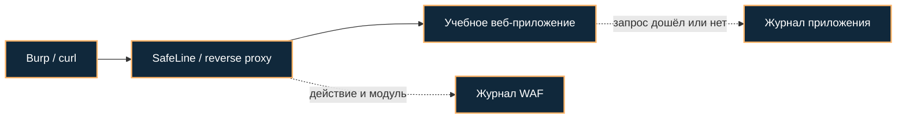

[Портфолио](../../../README.md) / [Web / OWASP](../README.md) / WEB-14

# WEB-14 · WAF SafeLine: настройка и проверка блокировок

> Защитить учебное приложение через reverse proxy и проверить результат на тестовых XSS/SQLi-запросах.

| Формат | Исходный кейс | Основной фокус |
| :-- | :-- | :-- |
| Учебная практика PT Start | `911` | Web / OWASP |

**Привязка к OWASP:** Защитный слой для A05:2025; журналы относятся к A09:2025.

## Стенд и схема

Учебное приложение и компоненты соответствующего кейса PT Start. URL, параметры и пути необходимо брать из своего стенда; примеры ниже поясняют проверку или исправление.



Схема показывает логику лабораторной. Для точного повторения исходного кейса используются его адресный план, образы и версии компонентов. Подготовка среды описана в [руководстве по стендам](../../../docs/lab-environment.md).

## Ход работы

1. Развернуть SafeLine и локальное учебное приложение.
2. Создать защищаемый application и указать адрес upstream, доступный из контейнера.
3. Проверить нормальный запрос через WAF и сравнить его с прямым доступом к приложению.
4. Отправить тестовые XSS и SQLi из кейса и найти соответствующие записи WAF.
5. Сопоставить HTTP-ответ, действие WAF и журнал приложения; проверить отсутствие прямого обхода защиты.

## Команды и контрольные проверки

```bash
docker ps
curl -i http://127.0.0.1:8000/
# Порт заменить на точку входа WAF в своём стенде.
# localhost внутри контейнера относится к контейнеру, а не к хосту.
```

Это команды проверки или пример исправления, а не сохранённый вывод с выполненного стенда. Полный набор действий зависит от подготовленного образа и версии ПО.

## Как подтвердить результат

- Схема WAF→upstream, разрешённый и заблокированный запросы.
- Событие SafeLine с временем, действием и модулем, подтверждение со стороны приложения.

Для фиксации фактического прогона используется [шаблон отчёта](../../../templates/run-report.md).

## Что важно для SOC

Запись об атаке не всегда означает блокировку. WAF снижает риск, но не доказывает исправление уязвимого кода; учитывать false positives и обход прямым доступом.

## Защита и повторная проверка

Закрыть прямой доступ к upstream, исправить код и настроить журналирование с корректной атрибуцией клиента.

После изменения конфигурации повторяется исходная проверка: нужно подтвердить устранение причины и сохранение штатной функции, а не только исчезновение ошибки в интерфейсе.

<details>
<summary>Источник и границы разбора</summary>

Тема и порядок действий адаптированы из пользовательского архива **«пт.zip»**, файл `tasks/911_Guided_Case_4.14_-_Настройка_WAF_Safeline.md`.
Это сжатый разбор учебной практики с добавленными схемой, критериями подтверждения и аналитическими пояснениями. Результаты чекеров и курсовые флаги не публикуются. Указания по официальной документации: [источники](../../../docs/sources.md).

</details>

---

[← Предыдущая](../13-sast/README.md) · [Все лабораторные](../README.md)
