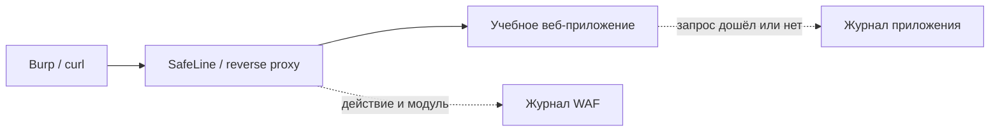

# WAF SafeLine: настройка и проверка блокировок

## Схема

## Что сделал

- Развернул SafeLine перед учебным веб-приложением.
- Проверил обычные запросы и блокировку тестовых XSS и SQL-инъекций.
- Сопоставил ответы приложения с действиями и журналами WAF.
