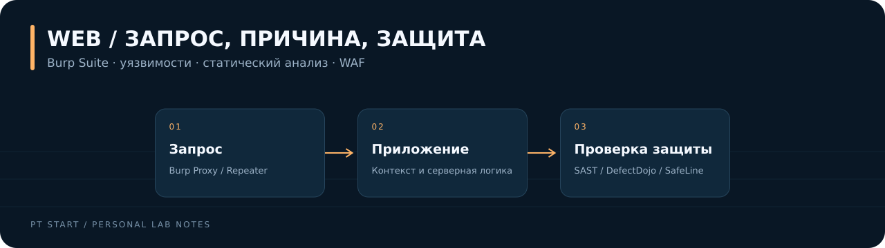

[← На главную](../../README.md)

# Веб-безопасность и OWASP

Проверка уязвимостей, статический анализ и защита приложения. В разделе **14 лабораторных** из архива PT Start.

| Лабораторная | Тема | ID исходного кейса |
| :-- | :-- | :-- |
| [WEB-01](01-burp-http/README.md) | [Burp Suite: перехват HTTP/HTTPS](01-burp-http/README.md) | `886` |
| [WEB-02](02-xss/README.md) | [XSS: отражённый и сохранённый ввод](02-xss/README.md) | `888` |
| [WEB-03](03-sql-injection/README.md) | [SQL Injection](03-sql-injection/README.md) | `890` |
| [WEB-04](04-idor/README.md) | [IDOR и объектная авторизация](04-idor/README.md) | `892` |
| [WEB-05](05-lfi/README.md) | [LFI: небезопасное подключение файлов](05-lfi/README.md) | `894` |
| [WEB-06](06-directory-traversal/README.md) | [Directory Traversal](06-directory-traversal/README.md) | `896` |
| [WEB-07](07-command-injection/README.md) | [Command Injection](07-command-injection/README.md) | `898` |
| [WEB-08](08-code-injection/README.md) | [Code Injection](08-code-injection/README.md) | `900` |
| [WEB-09](09-xxe/README.md) | [XXE и настройки XML-парсера](09-xxe/README.md) | `902` |
| [WEB-10](10-ssti/README.md) | [SSTI и граница шаблона](10-ssti/README.md) | `904` |
| [WEB-11](11-race-condition/README.md) | [Race Condition и атомарность операции](11-race-condition/README.md) | `906` |
| [WEB-12](12-defectdojo/README.md) | [DefectDojo: учёт результатов проверок](12-defectdojo/README.md) | `908` |
| [WEB-13](13-sast/README.md) | [Bandit и Semgrep: SAST и импорт результатов](13-sast/README.md) | `909` |
| [WEB-14](14-waf-safeline/README.md) | [WAF SafeLine: настройка и проверка блокировок](14-waf-safeline/README.md) | `911` |

Сопоставление лабораторных с категориями риска: [OWASP Top 10:2025](../../docs/owasp-coverage.md).

## Как читать разборы

В каждом кейсе: цель → схема → ход работы → контрольные команды → доказательства результата → взгляд SOC → защита.

Шаги описывают воспроизведение на учебных ВМ. Фактические версии и результаты собственного прогона фиксируются отдельно: [шаблон отчёта](../../templates/run-report.md).
