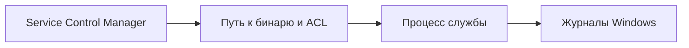

# Службы Windows и Unquoted Service Path

## Схема

## Что сделал

- Настроил учебную службу Windows и разобрал Unquoted Service Path.
- Проверил путь запуска, разрешения каталогов и контекст службы.
- Исправил путь, ограничил права и повторил проверку.
