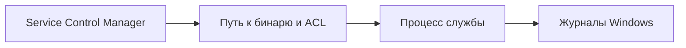

[Портфолио](../../../README.md) / [Windows](../README.md) / WIN-01

# WIN-01 · Службы Windows и Unquoted Service Path

> Разобрать конфигурацию службы, риск незакавыченного пути и влияние привилегий учётной записи.

| Формат | Исходный кейс | Основной фокус |
| :-- | :-- | :-- |
| Учебная практика | `834` | Windows |

## Стенд и схема

Windows/Windows Server с нужными ролями; для доменных команд — RSAT/модуль ActiveDirectory или GroupPolicy. Повышенная консоль нужна только для административных шагов.



Схема показывает логику лабораторной. Для точного повторения исходного кейса используются его адресный план, образы и версии компонентов. Подготовка среды описана в [руководстве по стендам](../../../docs/lab-environment.md).

## Ход работы

1. На учебной Windows сохранить параметры службы: путь, режим запуска и учётную запись.
2. Проверить путь с пробелами и разрешения на все родительские каталоги.
3. Воспроизвести сценарий из кейса с безопасным маркером и сопоставить запуск с журналами.
4. Заключить путь к исполняемому файлу в кавычки, ограничить запись в каталоги и перевести службу на подходящую малопривилегированную учётную запись.
5. Повторить проверку и сравнить поведение после исправления.

## Команды и контрольные проверки

```powershell
Get-CimInstance Win32_Service | Select-Object Name,StartName,PathName,StartMode
sc.exe qc LabService
Get-Acl 'C:\Program Files' | Format-List
```

Это команды проверки или пример исправления, а не сохранённый вывод с выполненного стенда. Полный набор действий зависит от подготовленного образа и версии ПО.

## Как подтвердить результат

- Параметры службы и ACL до/после исправления.
- Событие установки службы System/Service Control Manager 7045, если в эксперименте создавалась новая служба; данные запуска процесса при включённом аудите.

Для фиксации фактического прогона используется [шаблон отчёта](../../../templates/run-report.md).

## Что важно для SOC

Одних пробелов в PathName недостаточно: нужны подходящий порядок поиска и право записи в доступный путь. Смена контекста службы важнее названия бинаря.

## Защита и повторная проверка

Использовать кавычки, корректные ACL и минимальные привилегии. Прикладная совместимость LocalService проверяется отдельно.

После изменения конфигурации повторяется исходная проверка: нужно подтвердить устранение причины и сохранение штатной функции, а не только исчезновение ошибки в интерфейсе.

<details>
<summary>Источник и границы разбора</summary>

Тема и порядок действий адаптированы из пользовательского архива **«пт.zip»**, файл `tasks/834_Guided_Case_3.1_-_Настройка_служб.md`.
Это сжатый разбор учебной практики с добавленными схемой, критериями подтверждения и аналитическими пояснениями. Результаты чекеров и курсовые флаги не публикуются. Указания по официальной документации: [источники](../../../docs/sources.md).

</details>

---

[Все лабораторные](../README.md) · [Следующая →](../02-drivers-dll/README.md)
