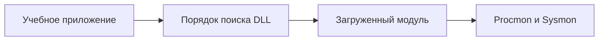

[Портфолио](../../../README.md) / [Windows](../README.md) / WIN-02

# WIN-02 · Драйверы, DLL Hijacking и Side-Loading

> Исследовать загрузку компонентов Windows и риск поиска DLL в доступных для записи каталогах.

| Формат | Исходный кейс | Основной фокус |
| :-- | :-- | :-- |
| Учебная практика | `836` | Windows |

## Стенд и схема

Windows/Windows Server с нужными ролями; для доменных команд — RSAT/модуль ActiveDirectory или GroupPolicy. Повышенная консоль нужна только для административных шагов.



Схема показывает логику лабораторной. Для точного повторения исходного кейса используются его адресный план, образы и версии компонентов. Подготовка среды описана в [руководстве по стендам](../../../docs/lab-environment.md).

## Ход работы

1. Снять инвентаризацию драйверов и проверить подписи выбранных компонентов.
2. В Process Monitor отфильтровать файловые операции учебного приложения и поиск отсутствующих DLL.
3. Разобрать сценарии поиска через каталог приложения и PATH на подготовленном стенде.
4. Сравнить hijacking и side-loading: в последнем случае важен контекст запуска легитимного загрузчика.
5. Проверить загруженные модули и вернуть исходное состояние приложения.

## Команды и контрольные проверки

```powershell
driverquery /v
Get-CimInstance Win32_SystemDriver | Select-Object Name,State,PathName
Get-AuthenticodeSignature 'C:\Labs\legitimate.exe'
$env:Path -split ';'
```

Это команды проверки или пример исправления, а не сохранённый вывод с выполненного стенда. Полный набор действий зависит от подготовленного образа и версии ПО.

## Как подтвердить результат

- Фильтры и события Process Monitor с поиском DLL.
- Пути загрузки, подписи и ACL каталогов; Sysmon 6/7 только при соответствующей конфигурации.

Для фиксации фактического прогона используется [шаблон отчёта](../../../templates/run-report.md).

## Что важно для SOC

DLL loading и driver loading — разные механизмы. Неподписанный модуль в пользовательском каталоге требует контекста; одна подпись легитимного EXE не делает все его DLL безопасными.

## Защита и повторная проверка

Закрыть запись в каталоги приложения и PATH, использовать явные пути загрузки и контролировать происхождение компонентов.

После изменения конфигурации повторяется исходная проверка: нужно подтвердить устранение причины и сохранение штатной функции, а не только исчезновение ошибки в интерфейсе.

<details>
<summary>Источник и границы разбора</summary>

Тема и порядок действий адаптированы из пользовательского архива **«пт.zip»**, файл `tasks/836_Guided_Case_3.2_-_Драйвера.md`.
Это сжатый разбор учебной практики с добавленными схемой, критериями подтверждения и аналитическими пояснениями. Результаты чекеров и курсовые флаги не публикуются. Указания по официальной документации: [источники](../../../docs/sources.md).

</details>

---

[← Предыдущая](../01-services/README.md) · [Все лабораторные](../README.md) · [Следующая →](../03-users-permissions/README.md)
